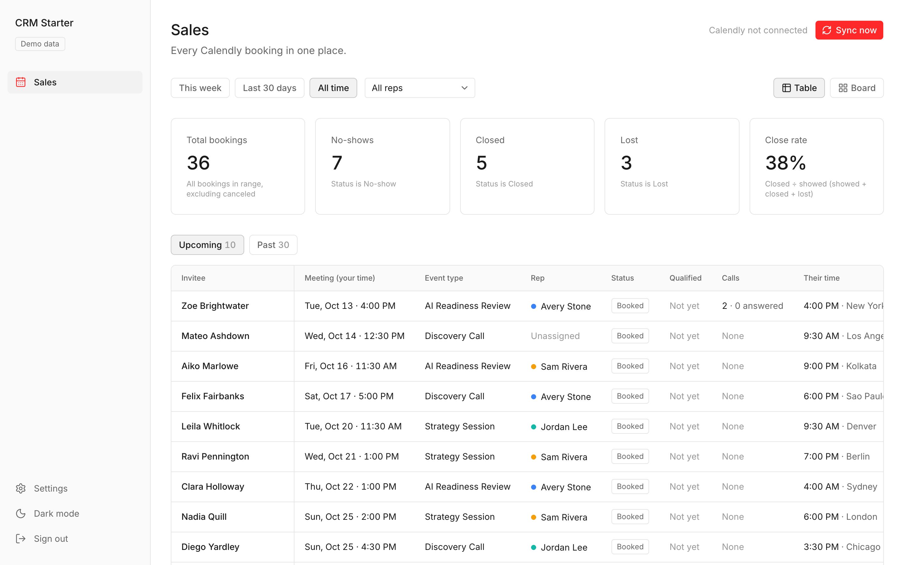

# CRM Starter

A simple CRM you run for your own business and grow with Claude Code or Codex. It ships
with one working module, the **Sales Dashboard** for Calendly bookings, inside a CRM
shell built so you can add your next module yourself.



*Screenshot taken in demo mode. Every name in it is fictional.*

## What it does

Your sales calls get booked through Calendly. This puts them all in one place, so your
team can see who was called, who answered and at what time of day, who's qualified (and
why not), and how each meeting ended.

- **Stats:** total bookings, no-shows, closed, lost and close rate, filtered by date and rep.
- **Table and board:** every booking in a table, or drag cards across Booked, Showed,
  No-show, Not qualified, Closed and Lost.
- **Booking side panel:** every Calendly detail, their time and your time side by side,
  Join call and Reschedule buttons, qualification, a call attempts log and notes.
- **Call attempts by hour:** a chart of when people actually pick up.
- **Reps:** add and remove sales reps in Settings.
- **Calendly sync:** works on Calendly's free plan (sync every 15 minutes, or click Sync
  now). Paid plans can add instant webhooks.
- **Demo mode:** with no Calendly token, the app runs on realistic fictional data, so you
  can try everything first.

Built with Next.js, TypeScript, Tailwind, shadcn/ui, Prisma and PostgreSQL, and
deployed on Railway.

---

## Run it on your computer (about 15 minutes)

### 1. Install the tools (one time)

- **Node.js 24 LTS** from [nodejs.org](https://nodejs.org) (choose the LTS version).
- **Git** from [git-scm.com](https://git-scm.com) (macOS may already have it; Windows: use the default options).
- A code editor or AI tool you like (VS Code, Cursor, Claude Code, Codex).

Check they work. Open **Terminal** (macOS) or **PowerShell** (Windows) and run:

```bash
node -v    # should print v22 or higher
git --version
```

### 2. Get the code

```bash
git clone <your copy of this repo's URL> crm-starter
cd crm-starter
```

(Or download the ZIP, unzip it, and `cd` into the folder.)

### 3. Get a database

The easiest way is a free-to-start Railway Postgres:

1. Sign up at [railway.com](https://railway.com).
2. **New Project > Database > PostgreSQL**.
3. Click the Postgres service, open **Variables**, and copy the value of
   **`DATABASE_PUBLIC_URL`**.

(Already have Postgres installed locally? You can use a local database URL instead.)

### 4. Add your settings

macOS:

```bash
cp .env.example .env
```

Windows (PowerShell):

```powershell
copy .env.example .env
```

Open `.env` in your editor and paste the URL from step 3 after `DATABASE_URL=`. That's
the only setting you need to start. Everything else is optional (see the table below).

### 5. Start it

```bash
npm install
npm run db:deploy
npm run dev
```

Open **http://localhost:3000**. You'll see the Sales Dashboard on demo data, with a
yellow bar reminding you that no password is set. That's fine on your own computer.

### 6. Connect Calendly (optional)

Add `CALENDLY_TOKEN` to `.env` (how to get one:
[docs/CONNECTIONS.md#calendly](docs/CONNECTIONS.md#calendly)), stop the app with
`Ctrl+C`, run `npm run dev` again, and click **Sync now**. The demo data is replaced by
your real bookings.

---

## Settings (environment variables)

All of these go in `.env` locally and in **Variables** on Railway. Full details, costs
and "what if it's missing" for each: **[docs/CONNECTIONS.md](docs/CONNECTIONS.md)**.

| Variable | Needed? | What it's for |
|---|---|---|
| `DATABASE_URL` | **Yes** | Your Postgres database ([details](docs/CONNECTIONS.md#railway-postgres)) |
| `APP_PASSWORD` | **Yes when deployed** | The one password your team signs in with ([details](docs/CONNECTIONS.md#app-password)) |
| `CALENDLY_TOKEN` | Optional | Syncs your Calendly bookings. Without it you get demo data ([details](docs/CONNECTIONS.md#calendly)) |
| `SYNC_SECRET` | Optional | Lets the 15-minute cron trigger a sync ([details](docs/CONNECTIONS.md#sync-secret)) |
| `CALENDLY_WEBHOOK_SIGNING_KEY` | Optional, paid Calendly | Instant updates by webhook ([details](docs/CONNECTIONS.md#calendly-webhooks)) |
| `APP_URL` | Optional | Your app's public address, for the cron and the webhook script |
| `TEST_DATABASE_URL` | Optional | A separate, empty database for `npm test` ([details](docs/CONNECTIONS.md#test-database)) |

To make a random secret for `SYNC_SECRET` or the webhook key, run `npm run secret`.

---

## Put it online (deploy to Railway)

Pick one method. Both end with the same result: your CRM at a `*.up.railway.app`
address, behind your password.

### Method A: click through the Railway dashboard

1. **Put the code on GitHub.** Create a **private** repository on github.com and push
   this folder to it. (`.env` is ignored by git, so your secrets stay on your computer.)
2. **Create the project.** On railway.com: **New Project > Deploy from GitHub repo**, and
   pick your repository. The first deploy may fail because there's no database yet.
   That's expected.
3. **Add the database.** In the project: **+ New > Database > Add PostgreSQL**.
4. **Set the variables.** Click your app's service > **Variables** and add:
   - `DATABASE_URL` = `${{Postgres.DATABASE_URL}}` (type it exactly like this)
   - `APP_PASSWORD` = a long passphrase for your team
   - `CALENDLY_TOKEN` = your Calendly token (optional, demo data without it)
   - `SYNC_SECRET` = the output of `npm run secret` (optional, for the cron)
5. **Get a web address.** App service > **Settings > Networking > Generate Domain**. Copy
   it and add it as the variable `APP_URL` (e.g. `https://your-app.up.railway.app`).
6. **Deploy.** Railway redeploys after variable changes. When it's green, open your
   address and sign in. `https://your-app.up.railway.app/api/health` should show
   `{"ok":true}`.

The build, migrations and health check are already set up in `railway.toml`.

### Method B: one prompt to Claude Code

Install the [GitHub CLI](https://cli.github.com) and the
[Railway CLI](https://docs.railway.com/guides/cli), sign in to both (`gh auth login`,
`railway login`), then open Claude Code in this folder and paste:

```text
Read CLAUDE.md and docs/CONNECTIONS.md. Then deploy this app to Railway using the gh and
railway CLIs:

1. Create a PRIVATE GitHub repository for this folder and push the code. Make sure .env
   is not committed.
2. Create a Railway project, add a PostgreSQL database, and add a service for this app
   connected to the GitHub repository.
3. On the app service, set DATABASE_URL to ${{Postgres.DATABASE_URL}}. Generate a
   SYNC_SECRET with `npm run secret` and set it directly without printing it.
4. Generate a public domain for the app service and set APP_URL to it.
5. Add the 15-minute cron as described in docs/CONNECTIONS.md#railway-cron (a second
   service from the same repo using /railway.cron.toml, with APP_URL and SYNC_SECRET).
6. Don't ask me to paste APP_PASSWORD or CALENDLY_TOKEN into this chat. Tell me exactly
   where to add them in the Railway dashboard, then wait for me.
7. When the deploy is green, check <APP_URL>/api/health returns {"ok":true} and tell me
   the address.

Before each step that creates something (repo, project, service, domain), tell me what
you're about to create and wait for my OK. Never print secret values.
```

### Sync every 15 minutes (Railway cron)

Calendly's free plan doesn't send instant updates, so a tiny second service asks the app
to sync every 15 minutes:

1. In your Railway project: **+ New > GitHub Repo**, and pick the same repository.
2. New service > **Settings > Config-as-code > Railway Config File**: `/railway.cron.toml`.
3. New service > **Variables**: `APP_URL` (your app's address) and `SYNC_SECRET` (same
   value as on the app).
4. Deploy. Its logs show one line per run, e.g. `Sync finished (200)`.

Step-by-step with details: [docs/CONNECTIONS.md#railway-cron](docs/CONNECTIONS.md#railway-cron).
On a paid Calendly plan you can also add instant webhooks:
[docs/CONNECTIONS.md#calendly-webhooks](docs/CONNECTIONS.md#calendly-webhooks).

---

## Make it yours

- **Rebrand:** change one line, `--brand`, in `src/theme/theme.css`
  ([docs/DESIGN.md](docs/DESIGN.md)). Rename the app with `APP_NAME` in
  `src/modules/index.ts`.
- **Add a module (a new tab):** follow [docs/ADDING-A-MODULE.md](docs/ADDING-A-MODULE.md).
  It has a ready-to-paste prompt for Claude Code or Codex.
- **Working with an AI assistant:** tell it *"read CLAUDE.md and search for AI-GUIDE
  comments"* before asking for changes. `BUILD.md` is the Sales module's build doc, and a
  good template for your own.

| Command | What it does |
|---|---|
| `npm run dev` | Run locally at http://localhost:3000 |
| `npm test` | Run the tests (do this after every change) |
| `npm run build` | Check the production build works |
| `npm run db:deploy` | Create or update the database tables |
| `npm run db:migrate -- --name what_changed` | After editing `prisma/schema.prisma` |
| `npm run db:studio` | Browse your data in a web page |
| `npm run secret` | Print a random secret |
| `npm run calendly:webhook -- create` | Register the optional Calendly webhook |

---

## Troubleshooting

**The password lock follows `NODE_ENV`.** When `APP_PASSWORD` is empty:
- `npm run dev` (development) leaves the app open and shows a yellow warning bar.
- `npm start` or a Railway deploy (production, `NODE_ENV=production`) locks every page
  behind a "Set APP_PASSWORD" screen. That includes running `npm start` on your own
  computer. Set `APP_PASSWORD` in `.env` (local) or Railway variables to unlock it.

**`npm install` reports "high severity vulnerabilities".** These warnings come from
the Prisma command-line tools (packages called `mysql2` and `deepmerge-ts` that Prisma
uses internally for migrations and other commands). They're safe to ignore: that code
only runs when you run a `prisma` command yourself, never inside your app while it
serves pages, and this app uses PostgreSQL, not MySQL. The only "fix" npm offers is
downgrading to an older Prisma major version, which would break the app. Don't run
`npm audit fix --force`.

**"Connect a database to get started".** `DATABASE_URL` is missing from `.env`. Add it
and restart `npm run dev`.

**"Can't reach database server" or the page says "Something went wrong".** Locally, use
the **public** URL (`DATABASE_PUBLIC_URL`), not the private one. The private address
(`*.railway.internal`) only works inside Railway. Also check the Postgres service is running.

**"The table ... does not exist".** Run `npm run db:deploy` to create the tables.

**`cp` isn't recognized (Windows).** Use `copy .env.example .env` in PowerShell.

**"Unsupported engine" or odd errors on install.** Your Node.js is older than 22.
Install the current LTS from nodejs.org and open a new terminal.

**Port 3000 is already in use.** Another app is running there. Stop it, or run
`npm run dev -- -p 3001` and open http://localhost:3001.

**Sync now says "Calendly rejected the token".** The token is wrong, incomplete or was
revoked. Create a new one in Calendly and update `CALENDLY_TOKEN`, then restart (or
redeploy on Railway).

**Only my own bookings come in, not my team's.** The token's owner needs to be a
Calendly organization admin to read everyone's bookings.

**The Railway deploy fails its health check.** Open the app service's **Deploy Logs**.
Usually `DATABASE_URL` isn't set to `${{Postgres.DATABASE_URL}}`, so migrations can't run.

**The cron service fails.** Check its **Variables** have `APP_URL` (with `https://`) and
the same `SYNC_SECRET` as the app, and that its config file is `/railway.cron.toml`.

**`npm ci` fails on Railway with a lockfile error.** `package-lock.json` is out of date.
Run `npm install` locally and commit the updated `package-lock.json`.

---

## Built by Monk

Built by **Monk** for members of The Profitable AI Consultant community.

Free to use for your own business and your clients; not for resale as a template.
